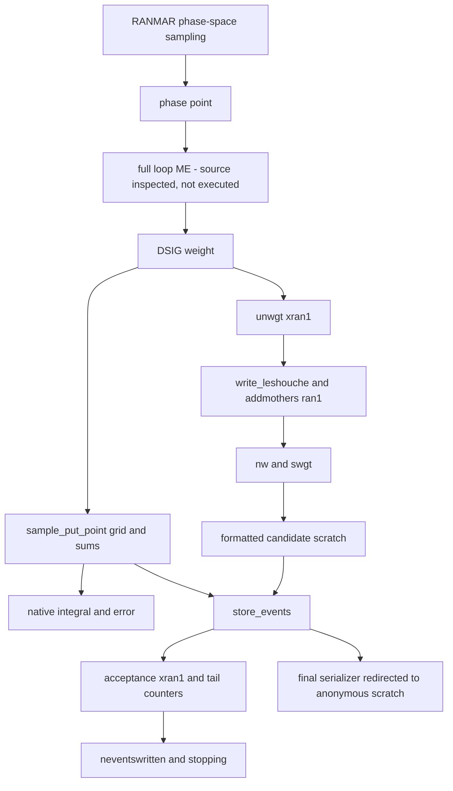

# Phase7H 原生積分語義

**READY_FOR_AUTHORIZED_NATIVE_VALIDATION；非完整 HH runtime VALIDATED。**
A 保留原始 computational bodies，將 final connection 接到已 unlink 的普通檔案；B 接 Fortran scratch。
兩者有完全相同的唯讀觀測碼。比較全數 native RNG／候選／格式化 readback／grid／sum／chi／error／停止 trace；數值用原生 bit pattern，離散值精確相同。
原生 sample_full、phase-space sampler、SMATRIX/MadLoop ME 不在方法 binary 的可連結入口中；exact-helicity grid hooks 與 multiplicity=1 使用明示 mock。
真正 native driver 另外建置四份，僅執行 pre-ME 出口及 STOP80 拒絕；未執行 survey。

candidate 更新實際發生在 DSIG 內、sample_put_point 之前。scratch readback 的 rounding 會參與 native acceptance；不能刪掉候選寫入或改成 /dev/null。
source-derived facts 與真實未執行部分分開，精確原始 SHA 與 PDF 路徑解析在 native_dependency_source_identity.json。

本報告為新增收尾紀錄，未覆寫歷史科學報告。原始 source/card/weight/6000 ME rows 及 F/G failures 保留。
證據：[manifest](../simulation/hh_signal/final_closure/evidence/manifest.json)、[操作指南](../simulation/hh_signal/final_closure/USER_GUIDE_ZH_TW.md)、[最終驗收](phase7_final_acceptance.md)。
